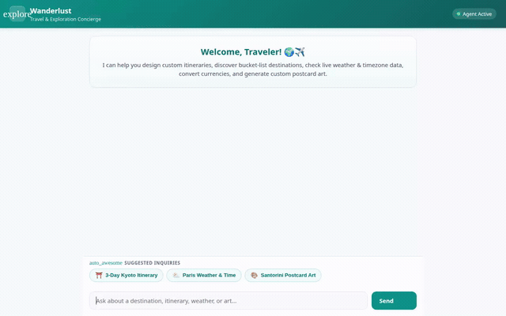

# Wanderlust — Travel & Exploration Concierge

An intelligent, multimodal travel planning agent built with Google's **Agent Development Kit (ADK)**, deployed to **Google Cloud Agent Platform (Agent Runtime)**, and surfaced through a responsive chat UI with **A2UI** on **Cloud Run**.

<p align="center">
  
</p>

---

## What Wanderlust Does

Wanderlust helps travelers discover, plan, visualize, and budget customized trips around the world. Based on the implemented codebase in `wanderlust-travel-agent/app/`, Wanderlust provides:

- **Destination Discovery & Catalog Search**: Queries a curated catalog of global destinations stored in Cloud Firestore (`destinations` collection) to find attractions, optimal travel seasons, and local highlights.
- **Custom Itinerary Planning & Persistence**: Generates structured, day-by-day cultural itineraries with activity schedules and estimated budgets, saving user travel plans directly to Cloud Firestore (`itineraries` collection).
- **Real-Time Currency Conversions**: Fetches live foreign exchange rates via the Frankfurter API to convert budgets and travel expenses across major world currencies.
- **Geographic Location Lookup**: Resolves geographic coordinates, addresses, and bounding boxes via the OpenStreetMap Nominatim API.
- **Destination Weather & Timezone Insights**: Simulates and retrieves local weather forecasts, conditions, and current local times across international timezones.
- **Multimodal Visual Postcards**: Uses Google's `gemini-3.1-flash-lite-image` model to generate high-resolution destination concept art and postcards, saving session artifacts and streaming image bytes to a public Google Cloud Storage bucket.
- **Multimodal Omni Video Generation**: Uses Google's Omni model (`gemini-omni-flash-preview`) in the `global` region via the GenAI Interactions API to generate cinematic travel video clips, saving session artifacts and uploading directly to Google Cloud Storage.
- **Rich A2UI Display**: Leverages the `A2UI` (v0.8) standard to present recommendations, itineraries, and generated media as rich, structured visual cards with native layout formatting rather than plain markdown text.

---

## Google Cloud Services & Integrations

The agent is implemented and wired to the following Google Cloud services:

| Component / Service | Implementation Details |
| :--- | :--- |
| **Agent Platform (Agent Runtime)** | ADK agent deployed using `agents-cli` (v1.4.0) over the **A2A** protocol. |
| **Gemini 3.6 Flash** (`gemini-3.6-flash`) | Core reasoning, tool orchestration, and conversation engine. |
| **Gemini Image Gen** (`gemini-3.1-flash-lite-image`) | High-resolution visual postcard generation via Google GenAI SDK. |
| **Gemini Omni** (`gemini-omni-flash-preview`) | Short cinematic destination video generation via the Interactions API (`location="global"`). |
| **Cloud Firestore** | NoSQL document database storing `destinations` catalog and `itineraries` user plans. |
| **Cloud Storage (GCS)** | Public storage bucket hosting generated travel postcards and video clips. |
| **A2UI (v0.8)** | Schema-validated UI rendering (`Card`, `Column`, `Row`, `Text`, `Image`) with `after_model_callback`. |
| **Cloud Run** | Containerized FastAPI proxy and branded chat web interface communicating with the agent runtime. |

---

## Feature Status

To ensure complete transparency regarding implemented vs. conceptual features:

### Implemented & Tested
- [x] Firestore destination catalog lookup (`list_destinations`, `get_destination_details`)
- [x] Firestore user itinerary persistence (`save_itinerary`, `add_destination`)
- [x] Live exchange rate conversions (`convert_currency`)
- [x] OpenStreetMap Nominatim geocoding (`lookup_location`)
- [x] Weather and local timezone resolution (`get_weather`, `get_current_time`)
- [x] Gemini image generation tool with artifact saving & GCS upload (`generate_destination_image`)
- [x] Gemini Omni video generation tool with artifact saving & GCS upload (`generate_destination_video`)
- [x] A2UI v0.8 callback and visual card layout generator
- [x] Custom FastAPI + A2A chat proxy and mobile-ready frontend
- [x] Unit test suite covering tools, database operations, and multimodal generation

### Planned, Not Yet Implemented
- [ ] *Vertex AI Memory Bank*: Cross-session long-term memory for remembering user travel preferences, dietary constraints, and preferred travel pace across independent sessions *(planned, not yet implemented)*.
- [ ] *Python Code Execution Sandbox*: Dynamic budget optimization and multi-day expense allocation algorithms *(planned, not yet implemented)*.
- [ ] *Google Maps Platform Integration*: Interactive map rendering and live Google Places API lookup *(planned, not yet implemented)*.
- [ ] *Cloud Trace Telemetry*: Distributed tracing across agent runtime and external tool APIs *(planned, not yet implemented)*.

---

## Project Structure

```
.
├── assets/
│   ├── demo.gif                      # Looping demo recording of Wanderlust chat UI
│   └── build-with-gemini-banner.png  # Project banner
├── project_brief.md                  # Initial project design and architecture brief
└── wanderlust-travel-agent/
    ├── app/
    │   ├── agent.py                  # Root agent definition, system prompts, and tools
    │   ├── a2ui_utils.py             # A2UI callback and payload extractor
    │   ├── fast_api_app.py           # FastAPI backend server
    │   └── app_utils/                # A2A, services, and execution helpers
    ├── frontend/
    │   ├── main.py                   # FastAPI proxy server connecting to Agent Engine
    │   ├── static/                   # Branded chat UI (HTML, CSS, JS, A2UI renderer)
    │   ├── Dockerfile                # Production container specification for Cloud Run
    │   └── requirements.txt          # Frontend Python dependencies
    ├── tests/
    │   └── unit/                     # Automated unit test suite
    ├── agents-cli-manifest.yaml      # Agent Platform deployment configuration
    └── pyproject.toml                # Agent project dependencies and tooling
```

---

## Getting Started & Local Setup

Follow these instructions to run Wanderlust locally on your development machine.

### Prerequisites
- **Python 3.11+**
- **uv** (recommended) or `pip`: [Installation Guide](https://docs.astral.sh/uv/)
- **Google Cloud SDK (`gcloud`)**: [Installation Guide](https://cloud.google.com/sdk/docs/install)
- **agents-cli**: Install via `uv tool install google-agents-cli`

### 1. Authenticate with Google Cloud
Ensure your local environment has authenticated application default credentials with access to Vertex AI, Firestore, and Cloud Storage:

```bash
gcloud auth login
gcloud auth application-default login
gcloud config set project <YOUR_GCP_PROJECT_ID>
```

### 2. Install Dependencies
Navigate into the agent project folder and install dependencies:

```bash
cd wanderlust-travel-agent
agents-cli install
```

### 3. Run the Agent Playground Locally
Launch the interactive ADK development UI:

```bash
agents-cli playground
```
This starts the local ADK developer server with hot-reload and artifact inspection.

### 4. Run the Custom Frontend Locally
To test the custom chat UI with the built-in A2UI renderer:

```bash
cd frontend
uv pip install -r requirements.txt

# Set the environment variables pointing to your agent deployment or local backend
export AGENT_ENGINE_RESOURCE_NAME="projects/<PROJECT_ID>/locations/<REGION>/reasoningEngines/<ENGINE_ID>"
export AGENT_DIRECTORY="app"
export PORT=8080

uv run python main.py
```

### 5. Running Automated Tests
Run unit tests across all tools (Firestore, currency conversion, geocoding, and image/video generators):

```bash
uv run pytest tests/unit -v
```

---

## Deployment Instructions

### Deploy Agent to Agent Runtime (Agent Platform)
From the `wanderlust-travel-agent/` directory:

```bash
agents-cli deploy
```

### Deploy Frontend to Cloud Run
From the `wanderlust-travel-agent/frontend/` directory:

```bash
gcloud run deploy wanderlust-frontend \
  --source . \
  --region us-central1 \
  --set-env-vars AGENT_ENGINE_RESOURCE_NAME="projects/<PROJECT_ID>/locations/<REGION>/reasoningEngines/<ENGINE_ID>",AGENT_DIRECTORY="app" \
  --allow-unauthenticated
```
Ensure the Cloud Run service account has `roles/aiplatform.user` granted so it can query the deployed agent runtime.
